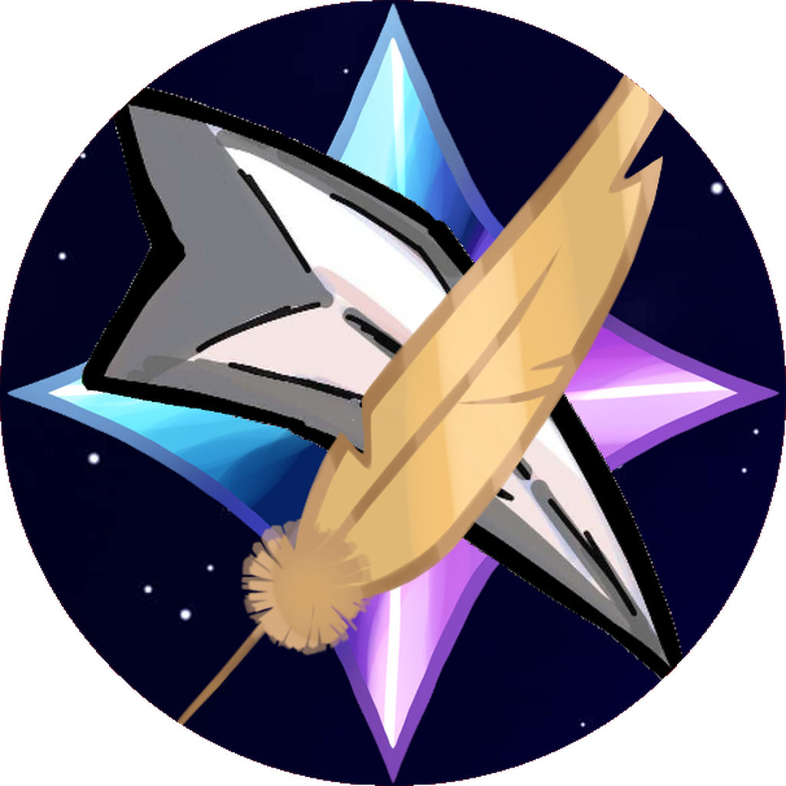

<div align="center">
  

  # Nyga Launcher

  **Le launcher Minecraft de Nyga**

  Un launcher personnalisé basé sur [Helios Launcher](https://github.com/dscalzi/HeliosLauncher).
</div>

---

## Présentation

Nyga Launcher est un launcher Minecraft personnalisé destiné aux joueurs de l'univers Nyga.

Son objectif est de simplifier l'accès aux serveurs Minecraft en centralisant la connexion et le lancement du jeu.

## Fonctionnalités

- Interface graphique personnalisée.
- Identité visuelle Nyga.
- Application basée sur Electron.
- Configuration de compilation avec Electron Builder.
- Préparation à la distribution de configurations Minecraft personnalisées.

## Téléchargements

Les versions compilées seront publiées dans la section [Releases](https://github.com/Realfoxu/NygaLauncher/releases).

## Installation pour les développeurs

Prérequis : Node.js 22 et npm.

```bash
npm ci
npm start
